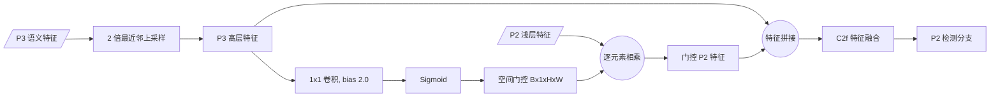

# YOLOv8-P2-Gated：面向 VisDrone 的小目标检测

[](https://www.python.org/)
[](https://pytorch.org/)
[](https://github.com/ultralytics/ultralytics)
[](LICENSE)

本项目基于 [Ultralytics YOLOv8](https://github.com/ultralytics/ultralytics)，针对 VisDrone 航拍场景中目标尺寸小、分布密集、遮挡严重和背景复杂等问题，研究高分辨率输入、P2 小目标检测头以及语义引导门控融合模块。

实验表明，P2 检测头能够改善小目标召回并减少漏检；当前 Gate 模块可以恢复部分 Precision，但没有超过纯 P2 模型的 mAP50-95。因此，本仓库将 P2 作为主要有效改进，将 Gate 作为结构探索和消融实验保留。

> 本项目包含完整的训练、统一验证、混淆矩阵分析、定性案例和 RTX 4090 推理性能测试。当前结果来自单随机种子实验，正式论文结论建议补充多随机种子均值与标准差。

## 项目亮点

- 在 YOLOv8s 中增加 P2/4 高分辨率检测分支，形成 P2、P3、P4、P5 四尺度检测。
- 使用高层 P3 语义特征生成空间门控，对浅层 P2 特征进行自适应过滤。
- 在完全一致的 `imgsz=960`、`batch=6` 和 VisDrone 验证集上完成公平消融。
- 针对 `pedestrian`、`people`、`bicycle` 和 `motor` 分析 FN、FP 与类别混淆。
- 在 RTX 4090 上完成 FP16、batch=1、960×960、warm-up 后的统一前向延迟测试。
- 提供分辨率实验、结构消融、PR/F1 曲线和典型检测案例。

## 模型结构

### P2-Gated Fusion

P3 特征首先上采样至 P2 分辨率，再通过 `1×1 Conv + Sigmoid` 生成单通道空间门控。门控作用于浅层 P2 特征，随后与上采样后的 P3 特征拼接并通过 C2f 融合。



模块实现位于：

- `ultralytics/nn/modules/block.py`：`P2GatedFusion` 和 `P2BiGatedFusion`
- `ultralytics/nn/tasks.py`：自定义模块解析与通道推导
- `ultralytics/cfg/models/v8/yolov8-p2.yaml`：P2 四尺度模型
- `ultralytics/cfg/models/v8/yolov8-p2-gate.yaml`：P2-Gate 模型
- `ultralytics/cfg/models/v8/yolov8-p2-bigate.yaml`：P2-BiGate 消融模型

可编辑版本：[优化路线图与 P2-Gated Fusion 结构图](https://www.figma.com/board/w5o793ALPHeLuY7QbH5yVe)。

## 实验结果

### 分辨率实验

| 模型    | 输入尺寸 | Batch | 最佳 epoch |        Precision |           Recall |            mAP50 |         mAP50-95 |
| ------- | -------: | ----: | ---------: | ---------------: | ---------------: | ---------------: | ---------------: |
| YOLOv8s |      640 |    32 |         87 |           0.5058 |           0.4032 |           0.3846 |           0.2209 |
| YOLOv8s |      960 |    16 |         58 |           0.5972 |           0.4799 |           0.4835 |           0.2906 |
| YOLOv8s |     1280 |     8 |         72 | **0.6393** | **0.5181** | **0.5403** | **0.3334** |

从 640 提升至 960 后，mAP50-95 增加 6.97 个百分点；从 960 提升至 1280 后进一步增加 4.28 个百分点。由于不同分辨率使用了适配显存的 batch，该表用于比较实际可运行配置，不代表固定有效 batch 下的纯分辨率消融。

### P2/Gate 消融实验

以下模型均在同一 VisDrone val、`imgsz=960`、`batch=6` 设置下重新验证。

| 模型            |       Precision |          Recall |           mAP50 |        mAP50-95 |  参数量 |
| --------------- | --------------: | --------------: | --------------: | --------------: | ------: |
| YOLOv8s         | **0.606** |           0.483 |           0.490 |           0.296 | 11.129M |
| YOLOv8s-P2      |           0.595 | **0.505** |           0.504 | **0.308** | 10.629M |
| YOLOv8s-P2-Gate | **0.606** |           0.498 | **0.505** |           0.306 | 10.629M |

相较 960 基线，P2 将 Recall 提高 2.2 个百分点、mAP50-95 提高 1.2 个百分点。Gate 相较 P2 恢复 1.1 个百分点的 Precision，但 Recall 降低 0.7 个百分点，mAP50-95 降低 0.2 个百分点。

### 小目标漏检分析

混淆矩阵使用 Ultralytics 验证默认 `conf=0.001` 和 IoU 匹配规则，适合比较错误模式，不应直接等同于部署阈值下的 FP/FN。

| 类别       | YOLOv8s FN | YOLOv8s-P2 FN |             变化 |
| ---------- | ---------: | ------------: | ---------------: |
| pedestrian |       1877 |          1562 | **-16.8%** |
| people     |       1498 |          1108 | **-26.0%** |
| bicycle    |        412 |           336 | **-18.4%** |
| motor      |        657 |           554 | **-15.7%** |
| 全部类别   |       5851 |          4695 | **-19.8%** |

P2 的主要收益来自漏检减少，尤其是 `people`、`bicycle`、`pedestrian` 和 `motor`。Gate 没有降低整体背景误检，因此不将其描述为已经验证成功的背景噪声抑制方案。

### RTX 4090 性能

统一条件：FP16、batch=1、960×960、融合 PyTorch 模型、100 次 warm-up、3×300 次 CUDA Event 测量。

| 模型            |           平均延迟 |      P95 |              FPS | 峰值 CUDA 显存 |
| --------------- | -----------------: | -------: | ---------------: | -------------: |
| YOLOv8s         | **5.319 ms** | 5.360 ms | **187.99** |      70.51 MiB |
| YOLOv8s-P2      |           6.530 ms | 6.580 ms |           153.13 |      99.52 MiB |
| YOLOv8s-P2-Gate |           6.574 ms | 6.867 ms |           152.12 |     102.41 MiB |

上述延迟仅包含 GPU 模型前向，不包含图像读取、预处理、NMS、CPU/GPU 传输和可视化。P2 相比基线增加约 22.8% 前向延迟；Gate 相比 P2 仅增加约 0.7%，表明主要额外开销来自 P2 四尺度检测而不是门控本身。

## 环境安装

推荐使用 Python 3.10、CUDA 兼容版本的 PyTorch 和 NVIDIA GPU。

```bash
git clone https://github.com/A8L00001/YOLOv8-P2-Gated-VisDrone.git
cd YOLOv8-P2-Gated-VisDrone

python -m venv .venv
source .venv/bin/activate
python -m pip install --upgrade pip
pip install -e .
```

本次实验环境：

- Python 3.10.12
- PyTorch 2.13.0+cu130
- Ultralytics 8.4.110
- NVIDIA GeForce RTX 4090 24 GB

不同 CUDA/PyTorch 组合可能产生轻微的速度和数值差异。

## 数据集准备

项目使用 [VisDrone2019-DET](https://github.com/VisDrone/VisDrone-Dataset)：

| 划分       | 图像数量 |
| ---------- | -------: |
| Train      |     6471 |
| Validation |      548 |
| Test-dev   |     1610 |

数据配置位于 `ultralytics/cfg/datasets/VisDrone.yaml`。准备后的目录结构如下：

```text
datasets/VisDrone/
├── images/
│   ├── train/
│   ├── val/
│   └── test/
└── labels/
    ├── train/
    ├── val/
    └── test/
```

`datasets/` 已在 `.gitignore` 中忽略，请不要把数据集上传到 GitHub。

## 训练

### YOLOv8s 960 基线

```python
from ultralytics import YOLO

model = YOLO("yolov8s.pt")
model.train(
    data="VisDrone.yaml",
    imgsz=960,
    epochs=150,
    batch=6,
    device=0,
    workers=8,
    optimizer="auto",
    amp=True,
    patience=150,
    close_mosaic=10,
    seed=0,
    deterministic=True,
    project="runs/detect",
    name="v8s_960_batch6_150e",
)
```

### YOLOv8s-P2

```python
from ultralytics import YOLO

model = YOLO("yolov8s-p2.yaml")
model.load("yolov8s.pt")
model.train(
    data="VisDrone.yaml",
    imgsz=960,
    epochs=150,
    batch=6,
    device=0,
    workers=8,
    optimizer="auto",
    amp=True,
    patience=150,
    close_mosaic=10,
    seed=0,
    deterministic=True,
    project="runs/detect",
    name="v8s_p2_960_batch6_150e",
)
```

### YOLOv8s-P2-Gate

将模型配置替换为 `yolov8s-p2-gate.yaml`，其他参数保持不变：

```python
model = YOLO("yolov8s-p2-gate.yaml")
model.load("yolov8s.pt")
```

仓库中也提供了对应脚本：

- `train_960_batch6.py`
- `train_p2_960_batch6.py`
- `train_p2_gate.py`
- `train_p2_bigate.py`

部分本地训练脚本包含原实验机器的绝对输出路径。迁移到其他机器时，请将 `project` 修改为相对路径 `runs/detect`。

## 统一验证

```python
from ultralytics import YOLO

models = {
    "normal": "path/to/normal_best.pt",
    "p2": "path/to/p2_best.pt",
    "p2_gate": "path/to/p2_gate_best.pt",
}

for name, weight in models.items():
    model = YOLO(weight)
    model.val(
        data="VisDrone.yaml",
        split="val",
        imgsz=960,
        batch=6,
        device=0,
        plots=True,
        project="runs/final_val",
        name=name,
    )
```

验证会生成混淆矩阵、Precision–Recall 曲线、F1/P/R 曲线以及标签与预测可视化。

## 推理

```python
from ultralytics import YOLO

model = YOLO("path/to/best.pt")
results = model.predict(
    source="path/to/image_or_video",
    imgsz=960,
    conf=0.25,
    device=0,
    save=True,
)
```

## 项目结构

```text
.
├── ultralytics/
│   ├── cfg/models/v8/
│   │   ├── yolov8-p2.yaml
│   │   ├── yolov8-p2-gate.yaml
│   │   └── yolov8-p2-bigate.yaml
│   └── nn/
│       ├── modules/block.py
│       └── tasks.py
├── train_960_batch6.py
├── train_p2_960_batch6.py
├── train_p2_gate.py
├── train_p2_bigate.py
├── runs/final_package/        # 本地实验归档，默认不上传
├── README.md
└── LICENSE
```

## 权重与实验产物发布

`.gitignore` 默认排除了 `*.pt`、`runs/`、图片和训练日志。推荐采用以下方式发布：

1. 源码、配置、训练脚本和 README 正常提交到 Git。
2. `best.pt` 上传至 GitHub Releases，或使用 Git LFS 管理。
3. VisDrone 数据集不要上传，只提供官方链接和目录说明。
4. 需要展示的少量结果图应复制到单独的 `docs/project-assets/`，再通过 `git add -f` 明确提交。
5. 不要提交 `.Trash-0`、`.ipynb_checkpoints`、缓存文件和完整 `runs/`。

## 当前结论与后续工作

- **有效改进：** P2 检测头减少小目标漏检，并提升 Recall 和 mAP50-95。
- **精度模型：** YOLOv8s@1280 获得当前最高 mAP50-95（0.3334）。
- **折中模型：** YOLOv8s-P2@960 在小目标召回和速度之间更均衡。
- **Gate 结论：** Gate 恢复部分 Precision，但当前没有超过纯 P2 的 mAP50-95。
- **后续重点：** 使用多个随机种子复现、统计 AP-small/AP-medium/AP-large，并在独立 test-dev 上完成最终评估。

## 致谢与引用

本项目基于以下开源项目和数据集：

- [Ultralytics](https://github.com/ultralytics/ultralytics)
- [VisDrone Dataset](https://github.com/VisDrone/VisDrone-Dataset)

如果本项目对你的工作有帮助，请同时引用 Ultralytics YOLO 和 VisDrone 的原始工作。

## License

本仓库沿用 Ultralytics 的 [AGPL-3.0 License](LICENSE)。如用于商业产品，请确认满足 Ultralytics 的许可要求。

Ultralytics 原始项目说明已保存在 [`README_ULTRALYTICS.md`](README_ULTRALYTICS.md)。
